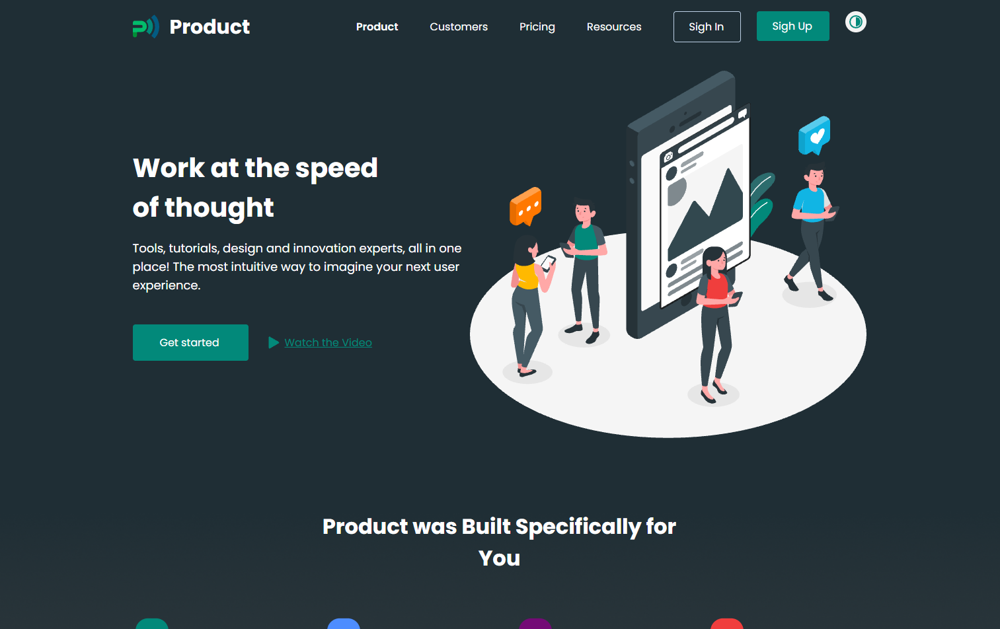
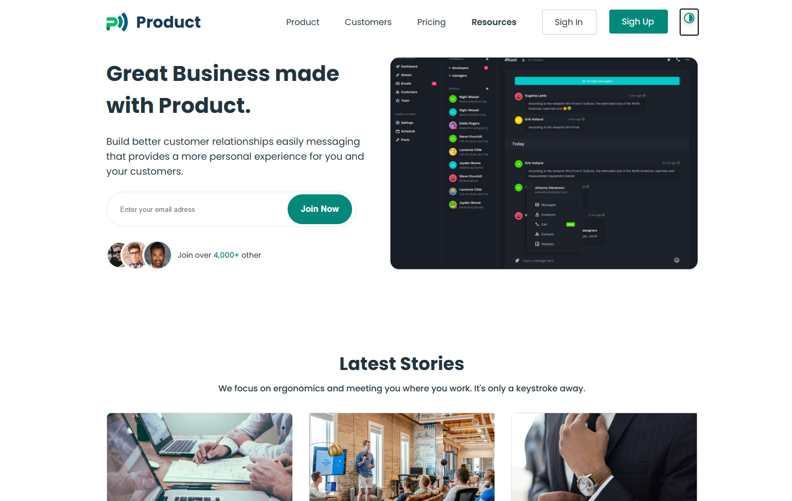

# Product

Одностраничный учебный проект (17 ноября 2022). Демонстрация навыков работы с HTML, CSS, JS.

## О проекте

Product — это сайт-визитка из 4 страниц. Проект создан в учебных целях для отработки вёрстки по макету, адаптивной сетки, изменение темы, прокрутки слайдов.


## Скриншоты

 
 

## Технологии

- HTML5
- CSS3
- JS

## Как запустить локально

1. Клонируй репозиторий:
   ```bash
   git clone https://github.com/Orimous/Dashly-X.git

